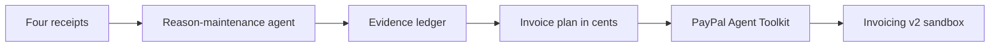

# Receipts Pay

Receipts Pay is a small agent that drafts a PayPal invoice from receipt facts, then revises that invoice when a source fact is retracted. Every billed amount points at a receipt. Retracting one fact recomputes only the amounts that depended on it.

The demo job is a gallery lighting install. Harbor Fieldwork bills Northline Studio. The first draft is **$440.00**. After the bad Volt & Co. supplier total is retracted, the same PayPal invoice is **$275.00**. Labor ($125.00) and freight ($40.00) do not move.

This is a standalone app. The receipt-and-retraction idea is the one behind a Hermes receipts plugin. Judges do not need Hermes, or any other host, to run it.

PayPal calls stay in the **sandbox**. If `PAYPAL_CLIENT_ID` and `PAYPAL_CLIENT_SECRET` are missing, the app runs in a clearly labeled **mock mode** and does not contact PayPal.

## Run it

```bash
npm install
npm test
npm run demo
```

Open [http://127.0.0.1:43123](http://127.0.0.1:43123).

`npm run demo:trace` prints the same $440 → $275 case in the terminal, including the PayPal tool names, without starting the web app.

Copy `.env.example` to `.env.local` when you have sandbox credentials. The server reads `.env.local` on its own. Do not commit that file.

## The demo case

| Evidence | Receipt | What it supports |
| --- | --- | --- |
| 5 hours | Timesheet TS-188 | Labor hours |
| $25.00 / hour | Rate card RC-2026 | Labor rate → **$125.00** |
| LED panels, 2 × $40.00 | Volt & Co. R-441 | $80.00, unused while the stamp is active |
| Mounting hardware, $30.00 | Volt & Co. R-441 | $30.00, unused while the stamp is active |
| Stamped total **$275.00** | Volt & Co. R-441 | Materials, until this fact is retracted |
| Freight $40.00 | Redcart R-442 | Freight |

The line items on R-441 sum to $110.00. The stamp is $165.00 higher because cancelled change order CO-19 was left in the total box. The agent records that conflict and, while the stamp is active, bills the stamp.

- Draft: $125 labor + $275 materials + $40 freight = **$440**
- Retract the stamp: materials recompute to $80 + $30 = $110
- Revised: $125 + $110 + $40 = **$275**
- Labor and freight keep their first evaluation. They are marked held.

## Sandbox setup

1. Create a free PayPal developer account at [developer.paypal.com](https://developer.paypal.com/).
2. Open the [Developer Dashboard](https://developer.paypal.com/dashboard/) and stay on **Sandbox**, not Live.
3. Use the sandbox **business** account. Invoicing has to be available on that account. PayPal's own guide is [Quick start using Invoicing API](https://developer.paypal.com/api/invoicing).
4. Go to **Apps & Credentials**. Create a REST app tied to that sandbox business account, or open the default app. Copy the **Sandbox** client ID and secret.
5. Create a sandbox **personal** account (the buyer). Copy its email address.
6. Put the values in `.env.local`:

```bash
PAYPAL_ENVIRONMENT=sandbox
PAYPAL_CLIENT_ID=your_sandbox_client_id
PAYPAL_CLIENT_SECRET=your_sandbox_secret
PAYPAL_RECIPIENT_EMAIL=the-sandbox-personal-email
```

7. Restart `npm run demo`. The badge should say **PayPal sandbox**.
8. Draft, retract, then **Send sandbox invoice**. In the sandbox business account, open Invoicing. The draft becomes an unpaid invoice. The personal account receives the email when PayPal delivers it.
9. **Cancel sent invoice** calls PayPal's cancel endpoint. A draft that was never sent is deleted instead, because PayPal's cancel API only applies to sent invoices ([Cancel sent invoice](https://developer.paypal.com/api/invoicing/v2/invoices-cancel), [Fully update invoice](https://developer.paypal.com/api/invoicing/v2/invoices-update)).

`PAYPAL_ENVIRONMENT` must be `sandbox` or unset. Any other value is refused. The app never calls `api.paypal.com` or `api-m.paypal.com`.

The official server SDK (`@paypal/paypal-server-sdk` 2.5.0, current as of November 2026) does not ship an Invoices controller. It covers Orders, Payments, Vault, Transaction Search, and Subscriptions. Receipts Pay uses PayPal's Agent Toolkit (`@paypal/agent-toolkit`) and its invoice tools: `create_invoice`, `update_invoicing`, `get_invoice`, `send_invoice`, `cancel_sent_invoice`, and `delete_invoice`. Those tools call Invoicing v2 on the sandbox host. See the [Agent Toolkit guide](https://developer.paypal.com/ai-tools/toolkit) and the [Invoicing v2 reference](https://developer.paypal.com/api/invoicing/v2).

## Architecture



- **Ledger.** Facts are asserted from receipts. Derived amounts (labor, materials, freight, total) remember the signature of their inputs and how many times they were evaluated. A retraction changes a signature only for nodes that used that fact. Unchanged nodes are held and are not evaluated again.
- **Policy.** While the Volt & Co. stamped total is active, materials use it. The line items stay in the ledger as unused evidence. The agent does not silently drop a source that is still active. A person retracts it.
- **Invoice plan.** Integer cents only. The PayPal line items are built from the supported nodes. If a retraction would leave labor, materials, or freight without evidence, the PayPal invoice is not changed and the fact stays active.
- **PayPal.** Create, full-replacement update, send, and cancel-or-delete go through the Agent Toolkit. An update of a draft does not notify the buyer. An update of an invoice that was already sent asks PayPal to notify. The toolkit is constructed with `context.sandbox: true`, and the base URL is checked for `sandbox.paypal.com` before a tool runs.
- **Mock.** Same gateway interface, no network. Invoice ids look like `MOCK-INV-1001`. The banner says mock mode.
- **Session.** One demo job, stored in `.data/session.json` so a refresh keeps the trail. That file is gitignored.

The agent is a reason-maintenance loop: assert, justify, derive, act, retract, recompute, revise. A chat model does not decide the money. The numbers come from the ledger.

## Honest limits

- One scripted job, not a general receipt inbox. There is no PDF upload, OCR, or multi-customer book.
- No tax, tip, partial payment, or currency other than USD.
- Mock mode is not PayPal. A judge can finish the $440 → $275 story without credentials. A sandbox account is required to show a real PayPal invoice.
- PayPal's update is a full replacement. Fields omitted from the body are cleared, so the app resends the whole invoice.
- The recipient can be changed only twice in 72 hours on PayPal's side. This demo does not change the recipient.
- Sending emails the sandbox personal account. Use an address you control.
- Resetting the page does not cancel a sent sandbox invoice. The warning tells you the id to cancel in the PayPal account.
- The app is one local session, not a multi-user product.
- It does not use AG Grid, APIMatic, Bryntum, Channel3, or Render, so it is not entered for those sponsor prizes.
- `@paypal/paypal-server-sdk` cannot create invoices today. If PayPal adds an Invoices controller later, the gateway can move behind it. The tool names would stay the same.

## Demo script

Aim for about two and a half minutes. No music. Do not put a PayPal logo file in the video. Saying "PayPal" while you show the sandbox invoice is the integration the hackathon asks for. Record the screen of this app, plus the sandbox Invoicing page if you have credentials.

1. **0:00** — Say who it is for. A small studio bills a client from receipts, and one supplier total is wrong. Changing that total by hand loses the reason the other numbers were right.
2. **0:15** — Show the four receipts. On Volt & Co. R-441, point at the line sum **$110.00** and the stamped total **$275.00**. Mention cancelled change order CO-19, **$165.00**.
3. **0:35** — Click **Draft PayPal invoice**. The ledger shows labor $125.00, materials $275.00 from the stamp, freight $40.00, total **$440.00**. The conflict stays visible. The PayPal card shows `create_invoice` and a draft id. If you are in sandbox, flash the same draft in the sandbox account.
4. **1:10** — Click **Retract stamped total**. Materials recompute to **$110.00**. The total becomes **$275.00**. Labor and freight say **Held** and still show one evaluation. The new lines are the LED panels and the mounting hardware. The trail names `update_invoicing`.
5. **1:45** — Click **Send sandbox invoice** (or **Send invoice (mock)**). Status becomes sent. If you want the cancel beat, open the confirm dialog and cancel. Say that a draft is deleted, and a sent invoice is cancelled, because that is how PayPal's API works.
6. **2:15** — Close on the trail. Each figure still names a receipt. The bad stamp is retracted. The amounts that did not depend on it were not recalculated.

## Devpost checklist

Submission deadline: **Thursday, November 12, 2026, 12:00 PM Pacific** (3:00 PM Eastern). Source: the [official rules](https://paypalaihackathon.devpost.com/rules) and the [hackathon page](https://paypalaihackathon.devpost.com/), read November 10, 2026. Rules win if the site and this list disagree.

Do this yourself. This repository does not submit the project or make it public.

- Join the hackathon on Devpost with the account that will submit. You must be the age of majority where you live. The rules exclude residents of Brazil, Quebec, Russia, Crimea, Cuba, Iran, North Korea, and other OFAC comprehensively sanctioned places, plus PayPal and Devpost staff, their households, judges, and affiliates.
- Build is new for this hackathon. If you mention the Hermes plugin, say this submission is a new standalone app written during the submission period, not that plugin.
- Text description of what it does, who it is for, and the $440 → $275 retraction.
- Tools field, honestly: PayPal Invoicing v2 through `@paypal/agent-toolkit` in the sandbox, and a local reason-maintenance agent. No third-party chat model decides amounts.
- Public GitHub, GitLab, or Bitbucket repo with this source, this README, and `LICENSE` (MIT, copyright 2026 Darren Foote) visible in the About section. GitHub picks that up from the `LICENSE` file.
- Functional demo. This README is the run path. Mock mode needs no secrets. If you also host a URL, keep it up through judging (judging runs December 1–15, 2026).
- YouTube video, public, under 3 minutes, no copyrighted music, link on the form. Show the app actually running the retraction and a PayPal create plus update, send, or cancel.
- English.
- No secrets, client ids, or sandbox passwords in the repo. If a judge needs a sandbox login, put the testing note in the Devpost form, not in git.
- One project can win at most one grand prize and one sponsor prize, or one honorable mention and one sponsor prize. This project does not qualify for the AG Grid, APIMatic, Bryntum, Channel3, or Render sponsor prizes.
- If you win, Devpost sends an affidavit. Return it within 10 business days. US winners may need a W-9. You are responsible for taxes. You keep the IP. PayPal gets a license to judge the entry and to promote it.

Questions about the rules go to the hackathon manager listed on the site (janet@devpost.com) or Devpost support (support@devpost.com).

## License

MIT. Copyright 2026 Darren Foote. See `LICENSE`.
